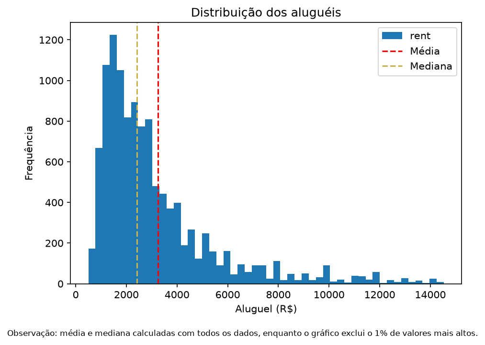
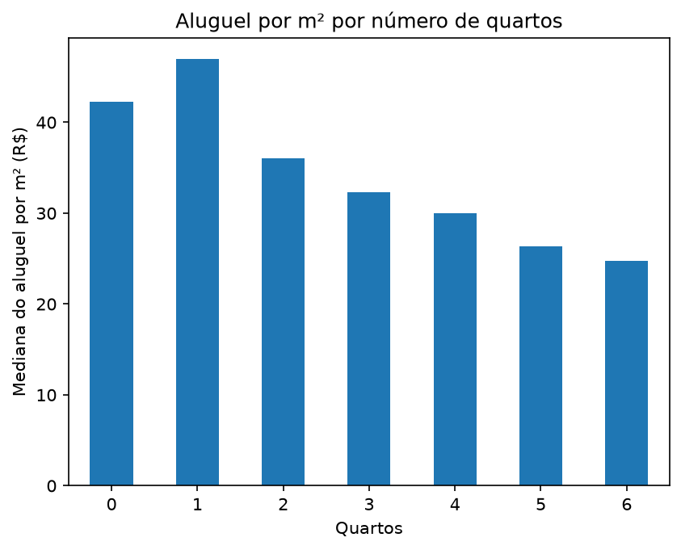
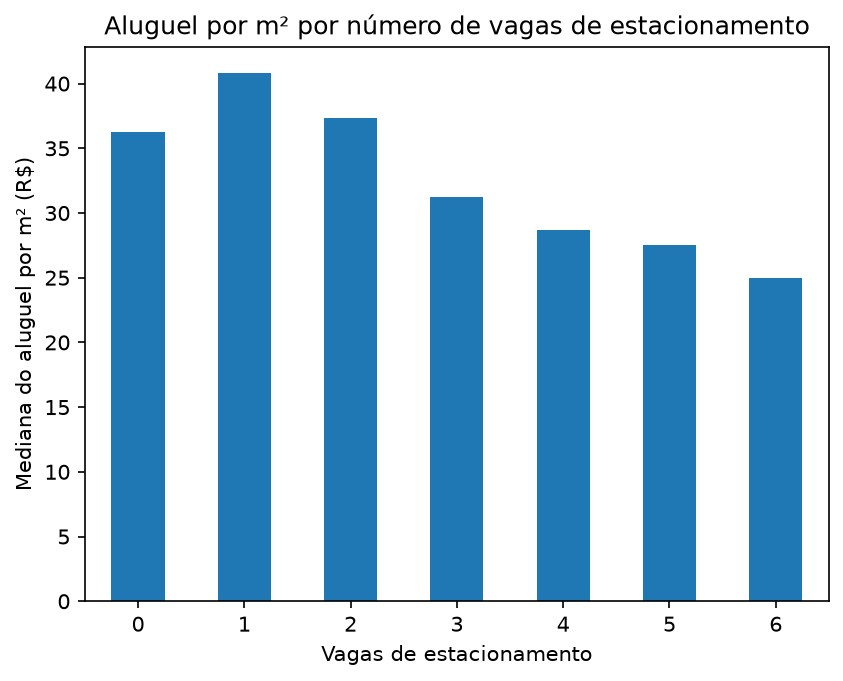

<!--
MODELO DE README - DESAFIO SYNAPTA - OPÇÃO 1: ANÁLISE DE PREÇOS DE ALUGUEL EM SÃO PAULO
Substitua tudo que estiver entre [colchetes] e apague os comentários antes de entregar.
Não deixe nenhum [colchete] restante no arquivo final.
-->

# Análise de Preços de Aluguel em São Paulo

Análise de preços de aluguel de imóveis da cidade de São Paulo, feita com base no dataset [**Sao Paulo housing prices**](https://www.kaggle.com/datasets/renatosn/sao-paulo-housing-prices), cujos dados foram extraídos em maio de 2023.

Este repositório foi criado como entrega do desafio inicial proposto na Etapa 2 do processo seletivo da SYNAPTA, pelo candidato **Luiz Carlos**, do 4° período do curso de Ciência da Computação.

## 1. Identificação do candidato

| Campo | Informação |
|---|---|
| Nome completo | Luiz Carlos dos Santos Júnior |
| Matrícula | 01805589 |
| Período atual | 4° período |
| Projeto escolhido | Opção 1 - Análise de preços de aluguel em São Paulo |
| GitHub | [Link do repositório](https://github.com/lucarl07/synapta) |

## 2. Objetivo e pergunta orientadora

**Objetivo:** Realizar uma análise de imóveis disponíveis para aluguel na cidade de São Paulo, relacionando sobretudo o aluguel com outros atributos, como localidade, área e amenidades presentes.

**Pergunta orientadora:** Quais características parecem acompanhar os maiores e os menores preços de aluguel, e o que os dados não permitem concluir?

**Tarefas desenvolvidas** (cada uma é respondida na seção indicada):

| # | Tarefa | Onde está |
|---|---|---|
| 1 | Descrever as colunas utilizadas com palavras próprias | Seção 4 |
| 2 | Linhas, colunas, valores ausentes, repetidos e inconsistentes | Seção 3 e Seção 8 |
| 3 | Decisões tomadas na preparação dos dados | Seção 8 |
| 4 | Preço médio e mediano, e por que diferem | Seção 9.1 |
| 5 | Localidades com maiores e menores preços médios | Seção 9.2 |
| 6 | Aluguel x pelo menos duas características | Seções 9.3 e 9.4 |
| 7 | Pelo menos três gráficos legíveis | Seção 9 |
| 8 | Pelo menos cinco conclusões objetivas | Seção 10 |
| 9 | Limitações da análise | Seção 11 |

## 3. Dataset

- **Nome:** Sao Paulo Housing Prices
- **Fonte:** [Link do dataset no Kaggle](https://www.kaggle.com/datasets/renatosn/sao-paulo-housing-prices/data)
- **Licença / condições de uso:** [CC0 1.0 Universal](https://creativecommons.org/publicdomain/zero/1.0/deed.pt-br)
- **Arquivo principal utilizado:** `data/Sao_Paulo_housing_prices_20230501.csv`
- **Outros arquivos do dataset (se houver):** Nenhum.
- **Dimensões originais:** 11658 linhas x 8 colunas
- **Filtro aplicado (se necessário):** [Ex.: o arquivo mistura anúncios de venda e aluguel; foram mantidos apenas os de aluguel, resultando em N linhas.]

## 4. Descrição das colunas utilizadas

| Nome | Nome traduzido | Tipo | O que representa |
|---|---|---|---|
| `address` | Endereço | Categórico | Parte do endereço do imóvel, mais especificamente o logradouro (rua, avenida, etc.) |
| `district` | Distrito | Categórico | Bairro em que o imóvel está localizado |
| `area` | Área | Numérico | Área do imóvel em metros quadrados (m²) |
| `bedrooms` | Quartos | Numérico | Quantidade de quartos |
| `garage` | Garagem | Numérico | Quantidade de garagens |
| `type` | Tipo | Categórico | Qual o tipo do imóvel (ex.: apartamento, casa, etc.) |
| `rent` | Aluguel | Numérico | Valor do aluguel mensal em reais brasileiros (R$) |
| `total` | Total | Numérico | Custo total mensal a ser pago, incluindo aluguel, condomínio, etc. |

## 5. Ferramentas e tecnologias

- **Linguagem / ferramenta principal:** Python
- **Bibliotecas:** `pandas` para análise de dados + `matplotlib` para geração de gráficos
- **Ambiente:** Neovim com NvChad + Claude Sonnet 5.5 (versão gratuita)
- **Versão do Python:** 3.14.8

## 6. Estrutura do repositório

```
.
├── README.md           # Este arquivo
├── main.py             # Arquivo principal da análise
├── requirements.txt    # Dependências Python
├── data/               # Arquivos do dataset
├── docs/               # Arquivos de documentação, usados somente para acompanhamento pessoal
├── images/             # Gráficos usados no README, gerados em main.py
└── utils/              # Funções complementares (validações, gráficos, etc.)
```

## 7. Como executar

### 7.1. Instalar dependências
```bash
git clone https://github.com/lucarl07/portfolio.git
cd portfolio
python -m venv venv
source .venv/bin/activate        # Windows: venv\Scripts\activate
pip install -r requirements.txt
```

### 7.2. Executar ou visualizar
```bash
python main.py
```

## 8. Limpeza e preparação dos dados

**Verificações realizadas:**

| Verificação | Resultado encontrado | Decisão tomada e justificativa |
|---|---|---|
| Valores ausentes | Nenhum valor ausente encontrado | Exibir (opcionalmente) ao usuário informações do dataset, mostrando que não há valores ausentes. |
| Registros repetidos | Nenhum registro repetido encontrado | Uso (opcional) da função `cleanse_data`, permitindo a substituição de valores ausentes + remoção de duplicatas, apenas no caso de uma eventual expansão do dataset. |
| Valores inconsistentes | 1. Ímóveis de área menor que o mínimo permitido <br/> 2. Nenhum quarto em imóveis que não são studios ou kitnets | De acordo com a Lei nº 16.642/2017 da cidade de São Paulo, um imóvel deve ter uma área útil total de pelo menos 8 m²; nem todos os registros com menos do que isso devem ter área menor (ex.: área não conseguiu ser inclusa no dataset), mas por fins de acurácia e por não estarem em grande quantidade, os registros foram removidos. <br/> 2. Novamente, esse dado pode não ter sido capturado, porém por serem poucos casos encontrados, esses registros simplesmente foram removidos. |
| Tipos de dados | Nenhuma inconsistência de dados encontrada. | Sem decisão necessária. |

**Filtros ou novas variáveis incrementadas:**
| Filtro/variável | Justificativa |
|---|---|
| Aluguel por metro quadrado (m²) | Permite obter uma métrica muito oscilante, importante para determinar o quão o imóvel é valorizado no mercado. |

**Resultado final:** Após passar por tratamentos, registros inconsistentes foram encontrados e removidos, e uma coluna adicional (Aluguel por metro quadrado) foi adicionada. O conjunto foi de 11657 linhas x 8 colunas para 11639 linhas x 8 colunas.

## 9. Resultados

### 9.1 Preço médio e mediano do aluguel

| Medida | Valor (R$) |
|---|---|
| Média | 3.250,50 |
| Mediana | 2.420,00 |

**Por que os valores diferem:** A média, por ser uma medida mais sensível a valores muito altos e/ou muito baixos - e também, possivelmente, pelo maior número de _outliers_ (valores discrepantes) de altíssimo aluguel -, ficou maior do que a mediana, que é um valor central, menos influenciado por eles.

### 9.2 Localidades com maiores e menores preços médios

**Critério de agrupamento:** Foram consideradas apenas localidades com no mínimo **8 registros**, porque parte considerável dos registros não possuia nem 3 imóveis listados; Ao filtrar os registros pelos bairros 25% mais recorrentes, foi encontrado que, de um todo de 300 localidades, a menos recorrente delas (Campanário) apareceu 8 vezes. Ao colocar o piso de ocorrências p/a análise como 8, foram inclusos mais 20 distritos, sendo o último da lista a Vila Arriete, totalizando 320 bairros analisados.

| Posição | Localidade | Preço médio (R$) | Nº de registros |
|---|---|---|---|
| Maiores 1 | Alphaville | 11.247,46 | [n] |
| Maiores 2 | Chácara Monte Alegre | 10.205,00 | [n] |
| Maiores 3 | Jardim Fonte do Morumbi | 9.449,00 | [n] |
| Menores 1 | Parque Edu Chaves | 1.110,44 | [n] |
| Menores 2 | Vila Campanela | 1.172,73 | [n] |
| Menores 3 | Jardim Vergueiro (Sacomã) | 1.220,25 | [n] |

### 9.3 Distribuição dos aluguéis (frequência)



**Descrição:** O gráfico mostra a frequência de 50 intervalos de valor de aluguel (de R$ 0 a R$ 14.000, aproximadamente) e sua frequência na base de dados.

**Observação:** Os _outliers_ (nesse caso, 1% dos valores mais altos) foram removidos, a fim de evitar que o gráfico ficasse muito espremido à esquerda.

### 9.4 Mediana do aluguel por metro quadrado (R$) x número de quartos



**Exemplo:** no conjunto dos registros com 2 quartos, a mediana do valor do aluguel por m² fica entre R$ 30,00 e 40,00.

### 9.4 Mediana do aluguel por metro quadrado (R$) x número de vagas de estacionamento



**Exemplo:** no conjunto dos registros que não tem nenhuma vaga de estacionamento, a mediana do valor do aluguel por m² fica um pouco acima de R$ 35,00.

## 10. Conclusões

<!-- Mínimo de 5 conclusões objetivas, cada uma apoiada em um resultado da seção 9. -->

1. [Conclusão 1 - ex.: "A mediana do aluguel (R$ X) é menor que a média (R$ Y), indicando valores muito altos que puxam a média para cima."]
2. [Conclusão 2 - sobre as localidades mais caras e mais baratas.]
3. [Conclusão 3 - sobre a relação entre aluguel e a característica 1.]
4. [Conclusão 4 - sobre a relação entre aluguel e a característica 2.]
5. [Conclusão 5]

### Resposta à pergunta orientadora

**Quais características parecem acompanhar os maiores e os menores preços?** [Resposta direta, baseada nas conclusões acima.]

**O que os dados não permitem concluir?** [Ex.: não permitem afirmar que a área *causa* o aluguel maior; não mostram o preço efetivamente pago; não representam todos os imóveis da cidade.]

## 11. Limitações da análise

- **Ausência de informações:** Senti a falta de um dado que seria bastante interessante para análise: a quantidade de banheiros no imóvel. Ademais, uma explicação melhor sobre a coluna de valor total do imóvel poderia ser dada.
- **Concentração dos anúncios:** Mais de 3/4 das localidades não possui nem 10 imóveis anunciados, o que dificultaria uma análise precisa agrupando os registros por bairro.

## 12. Sobre o uso de inteligência artificial (IA)

Utilizei o agente Claude Sonnet 5.5 para finalidades como:
- Estruturação inicial dessa documentação (README.md);
- Auxiliar no processo de extração dos dados necessários com `pandas`;
- Auxiliar na ideação dos tipos de gráficos a serem apresentados, com base nos dados obtidos;

Todas respostas foram verificadas, analisando em primeiro lugar as páginas de documentação para os recuros utilizados, testando o código e, quando cabível, comparando com registros reais no arquivo CSV. As decisões de limpeza, a interpretação dos resultados e as conclusões são de minha autoria.

## 13. Referências

- [Sao Paulo Housing Prices - Kaggle](https://www.kaggle.com/datasets/...)
- [Pandas: API Reference](https://pandas.pydata.org/docs/reference/api)
- [Matplotlib: API Reference](https://matplotlib.org/stable/api/)

---

Desenvolvido por **Luiz Carlos dos Santos Júnior** - 01805589 - 2026

